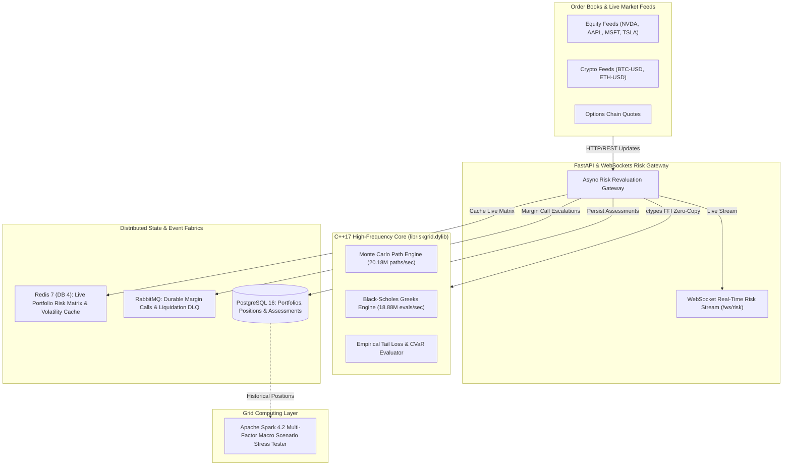

# RiskGrid — High-Frequency Algorithmic Portfolio Risk & Stress-Testing Grid

[](file:///Users/tejashr/Desktop/High-Frequency-Portfolio-Risk-Grid/src/riskgrid.cpp)
[](file:///Users/tejashr/Desktop/High-Frequency-Portfolio-Risk-Grid/python/api/main.py)
[](file:///Users/tejashr/Desktop/High-Frequency-Portfolio-Risk-Grid/python/spark/spark_portfolio_stress_tester.py)
[](file:///Users/tejashr/Desktop/High-Frequency-Portfolio-Risk-Grid/python/services/redis_service.py)
[](file:///Users/tejashr/Desktop/High-Frequency-Portfolio-Risk-Grid/python/services/rabbitmq_service.py)
[](file:///Users/tejashr/Desktop/High-Frequency-Portfolio-Risk-Grid/sql/schema.sql)
[](file:///Users/tejashr/Desktop/High-Frequency-Portfolio-Risk-Grid/python/tests/test_riskgrid.py)

**RiskGrid** is an ultra-low-latency algorithmic portfolio risk calculation and multi-factor stress-testing platform. Built for quantitative hedge funds and institutional trading desks, RiskGrid computes Value-at-Risk (95% & 99% VaR), Expected Shortfall (99% CVaR), and Black-Scholes analytical Greeks (Delta, Gamma, Vega, Theta) across cross-asset books in sub-milliseconds using an optimized C++17 Monte Carlo simulation engine.

---

## 🏛️ System Architecture



---

## ⚡ Hardware Benchmarks

Native C++ and asynchronous pipeline benchmarks executed on Apple Silicon (ARM64) with Clang 21.0.0 and PostgreSQL 16:

| Benchmark Dimension | Metric | Performance |
| :--- | :--- | :--- |
| **C++ Black-Scholes Greeks** | Throughput / Latency | **18.88 Million evals/sec** (52.96 ns/eval) |
| **C++ Monte Carlo Simulation** | Throughput / Latency | **20.18 Million asset-paths/sec** (24.77 ms / 100k paths) |
| **End-to-End Pipeline Throughput** | Sustained Revaluations | **301.0 full risk-evals/sec** (with Postgres, Redis & RabbitMQ) |
| **End-to-End Latency** | p50 / p95 / p99 | **45.84 ms** / **73.60 ms** / **109.04 ms** |

---

## 🛠️ Technology Stack

- **Languages:** C++17 (Geometric Brownian Motion, Box-Muller Normal Transforms, Black-Scholes Closed Form), Python 3.11+, SQL, JavaScript (ES6+), HTML5/CSS3.
- **Core Distributed Systems:** Zero-Copy Ctypes FFI, Asynchronous Starlette/FastAPI, WebSockets Full-Duplex PubSub.
- **Data & Caching Fabrics:** Redis 7 (DB 4 for Risk State & Volatility Caching), RabbitMQ (Durable Topic Exchange & Margin DLQ), PostgreSQL 16 relational storage.
- **Grid Analytics:** Apache Spark 4.2 Distributed Macro Stress Tester.
- **DevOps & Verification:** Docker, Docker Compose, GitHub Actions CI, Pytest Test Suite.

---

## 🚀 Quickstart & Reproduction

### 1. Build C++ Native Shared Library
```bash
clang++ -O3 -fPIC -dynamiclib -std=c++17 -I./include src/riskgrid.cpp -o libriskgrid.dylib
```

### 2. Run Native Hardware Benchmarks
```bash
clang++ -O3 -std=c++17 -I./include benchmarks/bench_engine.cpp -L. -lriskgrid -Wl,-rpath,. -o bench_engine
./bench_engine
```

### 3. Initialize PostgreSQL Database & Seed Topology
```bash
createdb riskgrid_db
psql -d riskgrid_db -f sql/schema.sql
```

### 4. Run Pytest Suite
```bash
pytest -v python/tests/test_riskgrid.py
```

### 5. Launch Risk Gateway
```bash
uvicorn python.api.main:app --host 0.0.0.0 --port 8000 --reload
```

---

## 🌐 Live Interactive Terminal

The interactive institutional risk dashboard is deployed live to:
👉 **[https://tejashr0716.github.io/riskgrid/](https://tejashr0716.github.io/riskgrid/)**
